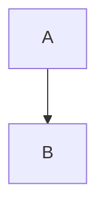

# Kitchen Sink

This file exercises every rendering feature Legible supports. If something looks wrong here, it looks wrong everywhere.

## Inline text

Plain, *emphasis*, **strong**, ***both***, ~~strikethrough~~, `inline code`, and a [link to the GFM spec](https://github.github.com/gfm/). An autolink: https://example.com/path?query=1. A footnote reference[^1] and another[^note]. Some <kbd>⌘</kbd> <kbd>E</kbd> keys, H<sub>2</sub>O, x<sup>2</sup>, and a line<br>break via `<br>`.

Text with a hard trailing-space break  
continues on the next line. A backslash at the end of a line\
does the same.

Unicode: café, naïve, 日本語, emoji 🍳, and a — dash with “curly quotes”.

[^1]: The first footnote.
[^note]: A named footnote with `code` and a [link](#inline-text).

## Headings

### Level three

#### Level four

##### Level five

###### Level six

A duplicate heading follows so anchor de-duplication gets exercised.

### Level three

## Lists

- Unordered item
- Another item with a nested list
  - Nested one
  - Nested two
    - Third level
- Item with a paragraph

  and a second paragraph inside it.

1. Ordered item
2. Second item
   1. Nested ordered
   2. Another
3. Third item

5. A list that starts at five
6. continues

- [ ] Unchecked task
- [x] Checked task
- [ ] Task with `code` and **bold**

Term definitions using plain paragraphs:

**Hashbrown**
: Grated potato, fried. Not a real definition list; GFM has none.

## Blockquotes

> A single-level quote with *emphasis* and a [link](https://example.com).
>
> Second paragraph of the same quote.
>
> > Nested quote.
> > With a second line.

> **Note**
> An old-style callout: just a quote with a bold word, left as it is.

> [!NOTE]
> A GitHub-style alert. The marker line becomes a title and the quote gets its colour.

> [!WARNING]
> Alerts can hold *formatting*, `code` and several paragraphs.
>
> Like this one.

> [!TIP]

> [!NOTE] Not an alert: the marker must be on its own line.

## Code

Inline `code` and a fenced block with a language:

```swift
import Foundation

/// Reads a file and counts the words.
func wordCount(at path: String) throws -> Int {
    let text = try String(contentsOfFile: path, encoding: .utf8)
    let words = text.split { $0.isWhitespace || $0.isNewline }
    return words.count   // 42
}
```

```bash
#!/bin/bash
set -euo pipefail
for f in *.md; do
  echo "$f: $(wc -w < "$f") words"
done
```

```json
{ "name": "legible", "version": "0.1.0", "private": true, "themes": 14 }
```

```diff
- old line removed
+ new line added
  unchanged context
```

```python
def fib(n: int) -> int:
    """Return the n-th Fibonacci number."""
    a, b = 0, 1
    for _ in range(n):
        a, b = b, a + b
    return a
```

```
A fence with no language. Copy should return exactly this,
including the    odd    spacing and trailing whitespace.   
```



```math
E = mc^2
```

    An indented code block
    with two lines.

A fenced block whose info string has extra words:

```yaml title="config.yml"
schema: 1
themes:
  light: oat-milk
  dark: burnt-toast
```

A code block that contains HTML, which must be shown, not interpreted:

```html
<script>alert("this is text, not a script")</script>

```

## Tables

| Theme         | Appearance | Contrast | Notes                       |
|:--------------|:----------:|---------:|-----------------------------|
| Oat Milk      | light      |     13.1 | Default light               |
| Burnt Toast   | dark       |      9.6 | Default dark, not black     |
| Salt & Pepper | light      |     21.0 | AAA                         |
| `Marmalade`   | dark       |      8.2 | Monospace body, *retro*     |

A wide table to check horizontal overflow:

| a | b | c | d | e | f | g | h | i | j | k | l | m | n | o | p | q | r | s | t | u | v | w | x | y | z |
|---|---|---|---|---|---|---|---|---|---|---|---|---|---|---|---|---|---|---|---|---|---|---|---|---|---|
| 1 | 2 | 3 | 4 | 5 | 6 | 7 | 8 | 9 | 10 | 11 | 12 | 13 | 14 | 15 | 16 | 17 | 18 | 19 | 20 | 21 | 22 | 23 | 24 | 25 | 26 |

## Images and links

A relative image: 

A relative SVG: 

A missing image shows its alt text: 

Links: [relative Markdown file](sibling.md) opens in Legible, [external](https://example.com) opens in the browser, [anchor](#tables) scrolls, and [parent directory](../README.md) resolves within the repository.

---

## Raw HTML: the safe subset

<details>
<summary>Click to expand (details/summary)</summary>

Hidden content with **Markdown** inside, and a code block:

```sh
echo "inside details"
```

</details>

<details open>
<summary>Open by default</summary>
Visible immediately.
</details>

<p align="center">
  
</p>

<div align="center">
  <strong>Centered div</strong> — a very common README pattern.
</div>


Text that wraps around a right-aligned image. Lorem ipsum dolor sit amet, consectetur adipiscing elit, sed do eiusmod tempor incididunt ut labore et dolore magna aliqua. Ut enim ad minim veniam, quis nostrud exercitation ullamco laboris nisi ut aliquip ex ea commodo consequat.

<br clear="all">

<picture>
  <source media="(prefers-color-scheme: dark)" srcset="images/mark.svg">
  
</picture>

Keyboard: <kbd>Ctrl</kbd> + <kbd>C</kbd>. Super<sup>script</sup> and sub<sub>script</sub>.

<table>
  <tr><th>HTML table</th><th>Cells</th></tr>
  <tr><td>works</td><td>fine</td></tr>
</table>

## Raw HTML: the malicious section

Everything below must render inert: no alerts, no requests, no forms, nothing covering the page. Each line names the attack it carries; only inert leftovers (plain text, alt text, harmless links) should remain.

<script>document.title = "pwned"; alert("script tag");</script>


<a href="javascript:alert('javascript: url')">javascript: link</a>

<iframe src="https://example.com"></iframe>

<object data="https://example.com"></object>
<embed src="https://example.com">

<form action="https://example.com/steal" method="post">
  <input name="password" type="password">
  <button>Submit</button>
</form>

<div style="position:fixed;top:0;left:0;width:100%;height:100%;background:red">style attribute overlay</div>

<link rel="stylesheet" href="https://example.com/evil.css">
<style>body { display: none !important; }</style>
<p>The style block above tries to hide the whole page.</p>

<meta http-equiv="refresh" content="0;url=https://example.com">
<base href="https://example.com/">


<svg onload="alert('svg')"><script>alert('svg script')</script></svg>
<math><mi xlink:href="javascript:alert(1)">x</mi></math>

<a href="https://example.com" target="_blank" rel="opener" onclick="alert('onclick')">link with handlers</a>

<video src="https://example.com/v.mp4" autoplay></video>
<audio src="https://example.com/a.mp3" autoplay></audio>

<p id="body">clobbering id</p>


<details ontoggle="alert('ontoggle')" open><summary>details with handler</summary>inert</details>

<!-- an HTML comment -->

End of the malicious section. This sentence is visible, so the "hide the page" style above was stripped.

## The end

Reading time and the end-of-document marker go here.
